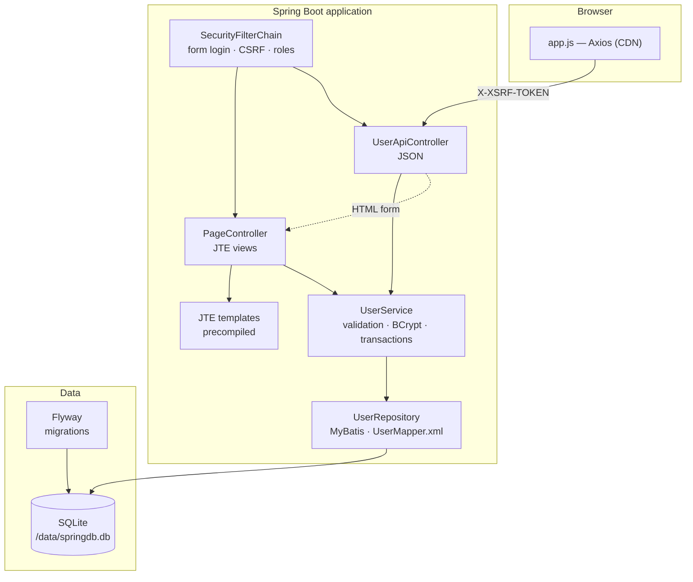
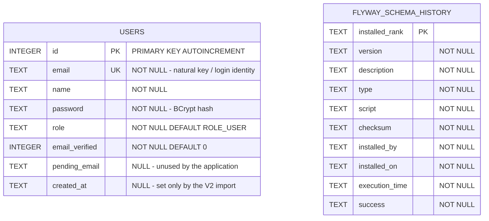
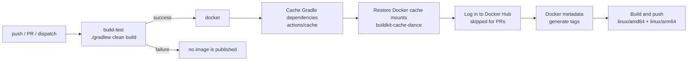

# Spring SQLite — Technical Documentation

Architecture, data model, containerization and CI/CD reference for the
`springsqlite` application.

> For quick-start instructions and feature overview, see [README.md](README.md).

## Table of contents

1. [System architecture](#1-system-architecture)
2. [Project layout](#2-project-layout)
3. [Data model — SQLite entity diagram](#3-data-model--sqlite-entity-diagram)
4. [Application design](#4-application-design)
5. [HTTP API reference](#5-http-api-reference)
6. [Security model](#6-security-model)
7. [Front end](#7-front-end)
8. [Docker containerization](#8-docker-containerization)
9. [CI/CD automation](#9-cicd-automation)
10. [Configuration reference](#10-configuration-reference)
11. [Local development](#11-local-development)
12. [Operations & troubleshooting](#12-operations--troubleshooting)
13. [Design decisions & known limitations](#13-design-decisions--known-limitations)

---

## 1. System architecture

A single-tenant user-management application rendered server-side, with a JSON
API consumed by Axios.

| Layer | Technology | Version |
|---|---|---|
| Language | Kotlin / JVM | 2.3.21 |
| Runtime | Java (Temurin) | 25 |
| Framework | Spring Boot | 4.1.0 |
| Web | Spring WebMVC + embedded Tomcat | 11.0.22 |
| Persistence | MyBatis (`mybatis-spring-boot-starter`) + HikariCP | 4.1.0 |
| Database | SQLite via `sqlite-jdbc` | 3.53.2.0 |
| Migrations | Flyway | managed by Boot |
| Templating | JTE (compile-time) | 3.2.4 |
| Frontend HTTP client | Axios (jsDelivr CDN) | 1.20.0 |
| Security | Spring Security (form login + CSRF) | managed by Boot |
| Build | Gradle (Kotlin DSL) + wrapper | 9.5.1 |



**Request lifecycle (server-rendered page, e.g. `GET /users`):**

1. `SecurityFilterChain` resolves the session principal; unauthenticated → `302 /login`.
2. `PageController.list()` collects shared model attributes (`contextPath`, `csrf`, `currentUser`) and page parameters.
3. `UserService.findPage()` clamps `page ≥ 1` and `size ∈ [1,100]`, computes the offset.
4. `MyBatisUserRepository` calls `UserMapper`, which executes the `findPage` and
   `count` statements from `mappers/UserMapper.xml` (`LIMIT ? OFFSET ?` plus a
   `COUNT(*)`), binding parameters as `?` placeholders.
5. JTE compiles `users/list.jte` to Java bytecode at build time; rendering produces HTML.

**Request lifecycle (JSON API, e.g. `POST /api/users`):**

1. Security checks the `ROLE_ADMIN` authority.
2. `UserApiController.create()` → `@Valid` on `UserRequest` (Bean Validation).
3. `UserService.create()` → `@Transactional`; lowercases the email, rejects duplicates with `409`, BCrypt-hashes the password, inserts through `UserMapper.insert` (`useGeneratedKeys`).
4. `ApiExceptionHandler` maps validation → `400 {error, fields}`, `ResponseStatusException` → its status, anything else → `500`.

---

## 2. Project layout

```text
springsqliteMyBatis/
├── .github/workflows/
│   ├── ci.yml                  # build + test on push/PR to master
│   └── docker-publish.yml      # build + push image to Docker Hub
├── gradle/wrapper/             # Gradle 9.5.1 wrapper
├── src/main/
│   ├── kotlin/com/example/springjte/
│   │   ├── SpringjteApplication.kt      # @SpringBootApplication entry point
│   │   ├── ServletInitializer.kt        # WAR deployment entry point
│   │   ├── config/DataInitializer.kt    # seeds the default admin
│   │   ├── controller/
│   │   │   ├── PageController.kt        # HTML/JTE routes
│   │   │   ├── UserApiController.kt     # /api/users JSON routes
│   │   │   └── LoginController.kt       # GET /login
│   │   ├── dto/UserRequest.kt           # inbound, Bean Validation
│   │   ├── dto/UserResponse.kt          # outbound (never carries the hash)
│   │   ├── config/MyBatisConfig.kt      # @MapperScan for the MyBatis mappers
│   │   ├── model/User.kt                # persistence model (mutable, MyBatis bean)
│   │   ├── model/Page.kt                # pagination envelope
│   │   ├── repository/UserRepository.kt # persistence contract (interface)
│   │   ├── repository/mybatis/
│   │   │   ├── UserMapper.kt            # @Mapper interface (no implementation)
│   │   │   └── MyBatisUserRepository.kt # adapter: LIKE escaping, generated key
│   │   ├── security/SecurityConfig.kt   # filter chain, roles, CSRF
│   │   ├── service/UserService.kt       # business rules, BCrypt, @Transactional
│   │   └── web/                         # ApiExceptionHandler, WebUtils
│   └── resources/
│       ├── application.properties
│       ├── mappers/UserMapper.xml       # every SQL statement
│       ├── db/migration/                # V1 schema, V2 seed data
│       ├── static/app.js                # Axios-based create-user form
│       └── templates/                   # JTE (.jte) sources
│           ├── fragments/               # head, navbar, sidebar, scripts
│           ├── users/                   # form, list, edit
│           ├── login.jte
│           └── error.jte
├── Dockerfile
├── docker-compose.yml
├── build.gradle.kts
└── settings.gradle.kts
```

---

## 3. Data model — SQLite entity diagram

The schema is deliberately minimal: one domain entity. Flyway's bookkeeping table
is the only other table.



### 3.1 Column reference — `users`

| Column | Type | Null | Default | Written by | Notes |
|---|---|---|---|---|---|
| `id` | INTEGER | no | — | AUTOINCREMENT | `INTEGER PRIMARY KEY AUTOINCREMENT`; monotonic, never reused |
| `email` | TEXT | no | — | app + V2 | Unique index `uk_users_email`; lowercased by the service before write |
| `name` | TEXT | no | — | app + V2 | Validated 2–50 characters |
| `password` | TEXT | no | — | app + V2 | BCrypt hash; 72-character limit is BCrypt's input cap |
| `role` | TEXT | no | `'ROLE_USER'` | app + V2 | `ROLE_USER` or `ROLE_ADMIN`; the service normalises any other value to `ROLE_USER` |
| `email_verified` | INTEGER | no | `0` | app (always `0`) | Legacy column — the application never sets it to `1` |
| `pending_email` | TEXT | yes | `NULL` | never | Legacy column, vestigial from the MySQL schema |
| `created_at` | TEXT | yes | `NULL` | V2 only | Text timestamp; newly created users have `NULL` |

### 3.2 Constraints and indexes

```sql
CREATE TABLE users (
    id INTEGER PRIMARY KEY AUTOINCREMENT,
    email TEXT NOT NULL,
    name TEXT NOT NULL,
    password TEXT NOT NULL,
    role TEXT NOT NULL DEFAULT 'ROLE_USER',
    email_verified INTEGER NOT NULL DEFAULT 0,
    pending_email TEXT,
    created_at TEXT
);
CREATE UNIQUE INDEX uk_users_email ON users(email);
```

| Object | Type | Purpose |
|---|---|---|
| `users.id` | PRIMARY KEY | Row identity; `AUTOINCREMENT` guarantees monotonically increasing IDs across deletes |
| `uk_users_email` | UNIQUE INDEX | Enforces one principal per email — the basis for `findByEmail` and login |

**There are no foreign keys.** The schema is a single aggregate; relationships are
expressed in application code, not in the database.

### 3.3 Logical vs. physical model

The physical table has 8 columns; the Kotlin persistence model exposes 5. The
column list is declared once in the mapper and included by every read statement:

```xml
<sql id="columns">id, name, email, password, role</sql>
```

MyBatis maps the columns onto the `User` properties by name (`resultType`), so no
explicit result map is needed.

| Physical column | `User` (Kotlin) | `UserResponse` (API) |
|---|---|---|
| `id` | `id: Long?` | `id: Long` |
| `name` | `name: String` | `name: String` |
| `email` | `email: String` | `email: String` |
| `password` | `password: String` | **never exposed** |
| `role` | `role: String?` | `role: String?` |
| `email_verified` | — | — |
| `pending_email` | — | — |
| `created_at` | — | — |

The password hash is read from the database (Spring Security needs it to
authenticate) but is deliberately absent from every DTO returned to clients.

### 3.4 Migrations

| Version | File | Effect |
|---|---|---|
| `V1` | `V1__create_users.sql` | Creates the `users` table and the unique email index |
| `V2` | `V2__import_mysql_users.sql` | Imports 7 users from the legacy MySQL database, preserving original IDs and BCrypt hashes so existing logins keep working |

Flyway runs automatically at startup (`spring.flyway.enabled=true`) and records
applied versions in `flyway_schema_history`. To reset the schema, delete the
database file and restart.

**Seeded data:** `V2` imports 7 users (two with `ROLE_ADMIN`, five with
`ROLE_USER`). `DataInitializer` additionally seeds
`admin@example.com` / `admin123` with `ROLE_ADMIN` if that email is not
already present.

---

## 4. Application design

### 4.1 Package responsibilities

| Package | Responsibility | Depends on |
|---|---|---|
| `model` | Persistence entities and pagination envelope | — |
| `dto` | Request/response contracts with validation annotations | `jakarta.validation` |
| `repository` | Persistence contract + the MyBatis mapper and its adapter | `model`, MyBatis |
| `service` | Business rules, password hashing, transaction boundaries | `repository`, `model`, `dto` |
| `controller` | HTTP mapping; server views vs. JSON | `service`, `dto`, `model` |
| `security` | Filter chain, `UserDetailsService`, password encoder | `repository`, `model` |
| `config` | Startup seeding | `repository` |
| `web` | API error mapping, CSRF helper | — |

The dependency direction is strictly inward: `controller → service → repository
→ model`. No layer reaches past its neighbour.

### 4.2 Key flows

**Create a user (`POST /api/users`)**

1. Bean Validation on `UserRequest`: name 2–50 chars, valid email, password 6–72 chars.
2. `UserService.create()` — `@Transactional`; email trimmed and lowercased; duplicate → `409 Conflict`; password → `BCryptPasswordEncoder.encode()`.
3. `UserRepository.save()` — `UserMapper.insert` runs the `INSERT` with `useGeneratedKeys="true" keyProperty="id"`, so SQLite's new rowid lands in `user.id`; `email_verified` is written as `0`; a null role becomes `ROLE_USER` via `coalesce`.
4. The row is re-read and mapped to `UserResponse` (no hash).

**Update a user (`PUT /api/users/{id}`)** — the email-uniqueness check excludes
the row being updated (`existingUser.id != id`), so a user may keep their own
email. A blank password means "keep the existing hash" rather than "set an
empty password".

**Search and pagination (`GET /users`)** — `page` is clamped to ≥ 1 and `size`
to `[1,100]`. `MyBatisUserRepository` turns the term into `%keyword%` and escapes
`\`, `%` and `_`; the XML uses `ESCAPE '\'`, so user input cannot inject
wildcards. The `WHERE` clause itself is a `<sql id="searchFilter">` fragment with
an `<if test="pattern != null">`, shared by `findAll`, `findPage` and `count`. `Page<T>` derives
`totalPages`, `hasPrevious` and `hasNext` as computed properties.

### 4.3 Persistence layer (MyBatis)

Four small pieces replace the previous `JdbcTemplate` class:

```text
UserService ──► UserRepository (interface)          repository/UserRepository.kt
                     ▲
                     │ implements
          MyBatisUserRepository ──► UserMapper (@Mapper)   repository/mybatis/
                                          ▲
                                          │ statements generated from
                                   resources/mappers/UserMapper.xml
```

| Concern | Where it lives |
|---|---|
| SQL text, dynamic `WHERE`, `LIMIT/OFFSET` | `UserMapper.xml` |
| Method → statement binding | `namespace` = mapper FQN, `id` = method name |
| Generated key | `<insert useGeneratedKeys="true" keyProperty="id" keyColumn="id">` |
| LIKE escaping (`\`, `%`, `_`) | `MyBatisUserRepository.pattern()` — kept in Kotlin so it is unit-testable |
| Mapper bean registration | `config/MyBatisConfig.kt` (`@MapperScan`) |
| Session factory, DataSource, transactions | Spring Boot auto-configuration + `spring-boot-starter-jdbc` |

**Configuration** (`application.properties`):

```properties
mybatis.mapper-locations=classpath:mappers/*.xml
mybatis.type-aliases-package=com.example.springjte.model
mybatis.configuration.map-underscore-to-camel-case=true
mybatis.configuration.jdbc-type-for-null=NULL
```

**Transactions.** `UserService.create/update/delete` are `@Transactional`, so the
mapper participates in the Spring-managed transaction over the same connection.
MyBatis needs no extra configuration for that — `MyBatisUserRepository` is a plain
`@Repository` and the mapper is a proxied bean.

**Adding a statement.** Add the method to `UserMapper` (every parameter annotated
with `@Param`), add a statement with the same id to the XML, then expose it on
`UserRepository` if the service needs it.

**Tests.** `MyBatisUserRepositoryTest` runs the real XML against a real SQLite file
(migrations included), so it catches broken statements, wrong `namespace`/`id`
pairs and escaping regressions; `InMemoryUserRepository` keeps the service and
controller tests database-free.

**Gotchas worth remembering**

* **Kotlin parameter names.** Kotlin does not write parameter names into the class
  file by default, so `#{pattern}` only resolves because of `@Param("pattern")`.
* **Mutable entity.** MyBatis fills entities through a no-arg constructor and
  setters, and `useGeneratedKeys` needs a writable `id`; hence `User` uses `var`.
* **`@MapperScan` placement.** It lives in a `@Configuration` class, not on
  `SpringjteApplication`: `@WebMvcTest` loads the application class and would try
  to build the mappers without a `DataSource` (*"Property 'sqlSessionFactory' or
  'sqlSessionTemplate' are required"*).
* **Null parameters.** `mybatis.configuration.jdbc-type-for-null=NULL` is required
  for `#{role}` to bind as SQL `NULL` on SQLite.
* **SQL logging.** `logging.level.com.example.springjte.repository.mybatis=DEBUG`
  prints `==>  Preparing: …` / `<==      Total: …` per statement.

---

## 5. HTTP API reference

### 5.1 Server-rendered routes

| Method | Path | Handler | Auth | Result |
|---|---|---|---|---|
| `GET` | `/login` | `LoginController` | public | `login.jte`; honours `?error` and `?logout` |
| `POST` | `/login` | Spring Security | public | Authenticates; success → `302 /` |
| `POST` | `/logout` | Spring Security | authenticated | `302 /login?logout`, session invalidated |
| `GET` | `/` | `PageController` | authenticated | `users/form.jte` |
| `GET` | `/users` | `PageController` | authenticated | `users/list.jte`; `?search=`, `?page=`, `?size=` |
| `GET` | `/users/{id}/edit` | `PageController` | `ROLE_ADMIN` | `users/edit.jte` |
| `POST` | `/users/{id}/update` | `PageController` | `ROLE_ADMIN` | `302 /users` + flash, or re-renders the form on `409` |
| `POST` | `/users/{id}/delete` | `PageController` | `ROLE_ADMIN` | `302 /users` + flash |

### 5.2 JSON API — `/api/users`

| Method | Path | Auth | Success | Errors |
|---|---|---|---|---|
| `GET` | `/api/users` | authenticated | `200` `UserResponse[]` | — |
| `GET` | `/api/users/{id}` | authenticated | `200` `UserResponse` | `404` |
| `POST` | `/api/users` | `ROLE_ADMIN` | `201` `UserResponse` | `400` validation, `409` duplicate email |
| `PUT` | `/api/users/{id}` | `ROLE_ADMIN` | `200` `UserResponse` | `400`, `404`, `409` |
| `DELETE` | `/api/users/{id}` | `ROLE_ADMIN` | `204` | `404` |

`GET /api/users` accepts an optional `?search=` parameter.

### 5.3 Error format

```json
// 400 - Bean Validation
{ "error": "Validation failed", "fields": { "email": "Email must be valid" } }

// 404 / 409 - ResponseStatusException
{ "error": "User not found" }
{ "error": "Email already registered" }
```

### 5.4 Operational endpoints

| Path | Purpose |
|---|---|
| `/actuator` | Exposed actuator links (1 endpoint) |

**Verified exposure (unauthenticated request):**

| Path | Response |
|---|---|
| `/login` | `200` |
| `/actuator`, `/actuator/health`, `/actuator/env` | `302 → /login` |
| `/api/users`, `/api/users/1`, `/users` | `302 → /login` |

---

## 6. Security model

### 6.1 Filter chain

```kotlin
http.authorizeHttpRequests { auth ->
    auth
        .requestMatchers("/login", "/css/**", "/js/**", "/favicon.ico", "/error").permitAll()
        .requestMatchers("/users/*/edit", "/users/*/update", "/users/*/delete").hasRole("ADMIN")
        .requestMatchers(HttpMethod.POST, "/api/users", "/api/users/*").hasRole("ADMIN")
        .requestMatchers(HttpMethod.PUT, "/api/users/**").hasRole("ADMIN")
        .requestMatchers(HttpMethod.DELETE, "/api/users/**").hasRole("ADMIN")
        .anyRequest().authenticated()
}
```

First match wins — the order is significant, because `/api/users` is both a
`GET` (authenticated) and a `POST` (admin).

### 6.2 Authority matrix

| Capability | Anonymous | `ROLE_USER` | `ROLE_ADMIN` |
|---|---|---|---|
| `GET /login` | ✅ | ✅ | ✅ |
| `GET /` , `GET /users` | ❌ | ✅ | ✅ |
| `GET /api/users`, `GET /api/users/{id}` | ❌ | ✅ | ✅ |
| `GET /users/{id}/edit` | ❌ | ❌ | ✅ |
| `POST /users/{id}/update`, `POST /users/{id}/delete` | ❌ | ❌ | ✅ |
| `POST /api/users` | ❌ | ❌ | ✅ |
| `PUT /api/users/{id}` | ❌ | ❌ | ✅ |
| `DELETE /api/users/{id}` | ❌ | ❌ | ✅ |

Note that **any authenticated user may read the full user list and any
individual user** via the JSON API; only mutations are admin-gated.

### 6.3 Password handling

- **Storage:** BCrypt (`BCryptPasswordEncoder`), 72-character input limit.
- **Lookup:** `UserDetailsService` resolves by email via `UserRepository.findByEmail`; the email is the username.
- **Role mapping:** `role` containing `ADMIN` → authority `ADMIN`; everything else → `USER`. `hasRole("ADMIN")` internally matches `ROLE_ADMIN`.
- **Import compatibility:** `V2` preserves the original MySQL BCrypt hashes, so pre-existing credentials continue to work.

### 6.4 CSRF

```kotlin
.csrf { csrf ->
    csrf.csrfTokenRepository(CookieCsrfTokenRepository.withHttpOnlyFalse())
    csrf.csrfTokenRequestHandler(CsrfTokenRequestAttributeHandler())
}
```

The token is published in a non-`HttpOnly` cookie (readable by JavaScript) and
sent as the `X-XSRF-TOKEN` header on the API calls made by `app.js`, and as a
`_csrf` form parameter by the server-rendered forms.

Axios performs this handshake natively: it reads the `XSRF-TOKEN` cookie and
sets the matching `X-XSRF-TOKEN` header on every same-origin request, so
`app.js` never has to touch the token itself. The cookie is written because
`PageController.addCommon()` reads the token while building the model — that
call is what triggers `CookieCsrfTokenRepository.saveToken`.

### 6.5 Session

Form login with `defaultSuccessUrl("/", true)` — always a redirect, never a
forwarded page. Logout invalidates the HTTP session and clears the
authentication.

---

## 7. Front end

**JTE** templates are compiled to Java bytecode at build time
(`gg.jte.use-precompiled-templates=true`, with `jte { generate() }` in
`build.gradle.kts`), so there is no template parsing at runtime and template
errors surface at build time.

| Template | Purpose |
|---|---|
| `login.jte` | Login form |
| `users/form.jte` | Create-user form (default landing page) |
| `users/list.jte` | Paginated, searchable user table |
| `users/edit.jte` | Edit form |
| `error.jte` | Error page |
| `fragments/head.jte` | `<head>`, Bootstrap 5.3.8 from CDN |
| `fragments/navbar.jte` | Top navigation |
| `fragments/sidebar.jte` | Side navigation |
| `fragments/scripts.jte` | Vendor `<script>` tags — Bootstrap, Axios, `app.js` |

Templates take typed parameters (`@param String title`,
`@param Page<UserResponse> pageData`) and compose fragments with
`@template.fragments.navbar(...)`.

### 7.1 Axios from a CDN

`fragments/scripts.jte` is the single place where third-party scripts are
declared, so a version bump is a one-line change:

```html
<script src="https://cdn.jsdelivr.net/npm/bootstrap@5.3.8/dist/js/bootstrap.bundle.min.js"
        integrity="sha384-FKyoEForCGlyvwx9Hj09JcYn3nv7wiPVlz7YYwJrWVcXK/BmnVDxM+D2scQbITxI"
        crossorigin="anonymous"></script>
<script src="https://cdn.jsdelivr.net/npm/axios@1.20.0/dist/axios.min.js"
        integrity="sha384-mIJWc6qj9ALoBF2yHkNOf0fbGel66+X3UkhYw57p36/PaTyDpO9pvnxrVZ7ZGJfi"
        crossorigin="anonymous"></script>
```

Both are version-pinned and protected by Subresource Integrity, so a mutated
file is rejected by the browser rather than executed. `crossorigin="anonymous"`
is required for SRI to be enforced cross-origin.

The fragment takes a `withApp` flag: `users/form.jte` passes `true` and also
loads `app.js`, while `users/list.jte` and `users/edit.jte` pass `false` and
skip the Axios download entirely, because neither page issues an XHR request.

### 7.2 `static/app.js`

`app.js` intercepts the create-user form's submit event and posts JSON via
Axios, then renders the success or validation error inline. There is no
frontend build step, no npm and no bundler.

Axios removes most of the request boilerplate — it serialises the JSON body,
sets `Content-Type: application/json`, and attaches the `X-XSRF-TOKEN` header
by reading the `XSRF-TOKEN` cookie that Spring Security publishes. What remains
is irreducible DOM work: locating the elements, cancelling the native submit,
rendering the Bootstrap alert, and mapping the API's error envelope
(`{error, fields}`) onto a human-readable sentence.

Two details worth knowing:

- **Relative endpoint.** `app.js` posts to `"api/users"`, resolved by the
  browser against the document, which preserves the servlet context path
  (`/` → `/api/users`, `/app/` → `/app/api/users`). This only holds while
  `app.js` is loaded on a page at or directly under the context root.
- **Expired sessions resolve successfully.** When the session lapses, the API
  302-redirects to `/login`, the browser follows it transparently, and Axios
  resolves with an HTML body instead of rejecting. `app.js` detects the
  non-object payload and reports "Session expired" rather than rendering
  `User "undefined" created`.

---

## 8. Docker containerization

### 8.1 Multi-stage build

```dockerfile
# ---------- Build stage ----------
FROM --platform=$BUILDPLATFORM gradle:9.5.1-jdk25 AS build
WORKDIR /app
COPY settings.gradle.kts build.gradle.kts gradle.properties* ./
COPY gradle ./gradle
COPY gradlew ./gradlew
RUN chmod +x ./gradlew
COPY . .
RUN --mount=type=cache,target=/root/.gradle \
    ./gradlew clean bootWar --no-daemon -x test \
    && cp build/libs/*.war /app/app.war

# ---------- Runtime stage ----------
FROM eclipse-temurin:25-jre
WORKDIR /app
COPY --from=build /app/app.war /app/app.war
RUN mkdir -p /data
VOLUME ["/data"]
ENV DB_URL=jdbc:sqlite:/data/springdb.db
ENV SERVER_PORT=8080
EXPOSE 8080
ENTRYPOINT ["java", "-jar", "/app/app.war"]
```

| Design choice | Reason |
|---|---|
| Two stages | The Gradle/JDK toolchain never enters the runtime image — only a JRE and the WAR |
| `FROM --platform=$BUILDPLATFORM` | The build stage always runs **natively on the builder**, so Gradle compiles once and the platform-independent WAR is reused for every target architecture. Without it, an arm64 build would re-run the 5-minute Gradle build under QEMU emulation |
| `cp build/libs/*.war /app/app.war` | The runtime stage copies a stable filename. The Gradle artifact name depends on `rootProject.name` and the version, so hard-coding it breaks whenever either changes |
| `COPY` descriptors before sources | Layer caching: a source-only change reuses the descriptor layer and the Gradle dependency cache |
| `RUN chmod +x ./gradlew` | The wrapper's executable bit is not preserved across all Git checkouts |
| `--mount=type=cache,target=/root/.gradle` | Reuses the Gradle distribution and dependency cache between builds on the same builder |
| `VOLUME ["/data"]` | Declares the persistence point; the SQLite file lives outside the image layer |
| `ENV DB_URL` | Spring resolves `${DB_URL:jdbc:sqlite:springdb.db}`; the container overrides the local default |

> **Note on the cache mount:** BuildKit does **not** export cache mounts through
> `--cache-to` and does **not** restore them via `--cache-from`. On CI, where
> every run starts a fresh builder, the mount begins empty — which is precisely
> why the [cache dance](#95-cache-dance) exists.

### 8.2 Build context

`.dockerignore` excludes `.git`, `build/`, `.gradle/`, local `*.db` files, IDE
directories, and `Dockerfile` / `docker-compose*.yml`. It also excludes
`.github/` — otherwise every workflow-only change would invalidate the
`COPY . .` layer and force a full Gradle rebuild for files the image never
contains.

`.gitattributes` pins LF endings for `*.yml` and `Dockerfile` so Windows
checkouts cannot introduce CRLF that would break GitHub Actions `run:` blocks.

### 8.3 Compose

```yaml
services:
  springsqlite:
    build:
      context: .
      dockerfile: Dockerfile
    image: harrysuke/springsqliteAxios:latest
    container_name: springsqlite
    ports:
      - "8080:8080"
    environment:
      DB_URL: jdbc:sqlite:/data/springdb.db
    volumes:
      - springsqlite-data:/data
    restart: unless-stopped

volumes:
  springsqlite-data:
    name: springsqlite-data
```

| Field | Purpose |
|---|---|
| `build` + `image` | Builds locally **and** tags the result with the registry-qualified name, so `docker compose pull` and `docker compose up --build` both work |
| `ports` | Host `8080` → container `8080` |
| `environment.DB_URL` | Points the database at the volume instead of the working directory |
| `volumes` | Named volume `springsqlite-data` mounted at `/data` — data survives rebuilds |
| `restart: unless-stopped` | The container comes back after a daemon restart or crash |

### 8.4 Image matrix

| Property | Value |
|---|---|
| Repository | `docker.io/harrysuke/springsqliteAxios` |
| Tags | `latest`, `sha-<short>`, semver tags from `v*` git tags |
| Architectures | `linux/amd64`, `linux/arm64` |
| Compressed size | ~154 MB per architecture |
| Uncompressed | ~566 MB |
| Digest | `sha256:625e01049ecda1e4b21e461250e2e13debe72f78a5f265bbad21added2734a05` |

> **Note:** the repository was renamed from `harrysuke/springsqlite` to
> `harrysuke/springsqliteAxios`; the size and digest rows above were measured
> on the image published under the previous name and are refreshed by the next
> publish.

The manifest list also carries two `unknown/unknown` entries — BuildKit
**provenance attestations** describing how the image was built. They are
supply-chain metadata, not additional images.

### 8.5 Common commands

```bash
# Build and run
docker compose up --build -d
docker compose logs -f springsqlite
docker compose ps

# Pull the published image
docker compose pull
docker run -d -p 8080:8080 -v springsqlite-data:/data harrysuke/springsqliteAxios:latest

# Multi-architecture build
docker buildx build --platform linux/amd64,linux/arm64 -t harrysuke/springsqliteAxios:latest --push .

# Reset the database
docker compose down -v && docker compose up --build
```

---

## 9. CI/CD automation

Two GitHub Actions workflows live in `.github/workflows/`.

### 9.1 `ci.yml` — build and test

| Field | Value |
|---|---|
| Triggers | `push` → `master`, `pull_request` → `master` |
| Runner | `ubuntu-latest` |
| Steps | `actions/checkout@v7` → `actions/setup-java@v6` (Temurin 25, `cache: gradle`) → `./gradlew clean build --no-daemon` |

> **History:** this workflow originally triggered on `main`. The project lives on
> `master` (`main` contains only a `LICENSE`), so it had never run. The trigger
> was corrected and the actions were bumped to current majors.

### 9.2 `docker-publish.yml` — build and publish

| Field | Value |
|---|---|
| Triggers | `push` → `master` and `v*` tags, `pull_request` → `master`, `workflow_dispatch` |
| Concurrency | `docker-publish-${{ github.ref }}`, `cancel-in-progress: true` |
| Jobs | `build-test` → `docker` |



**The `needs: build-test` dependency is the point of the pipeline:** a failing
test prevents the image from being published.

### 9.3 Tag scheme

`docker/metadata-action@v6` generates the tag list:

| Rule | Produces | When |
|---|---|---|
| `type=raw,value=latest,enable={{is_default_branch}}` | `latest` | push to the default branch (`master`) |
| `type=raw,value=latest,enable=${{ github.ref_type == 'tag' }}` | `latest` | any tag push |
| `type=sha,format=short` | `sha-<7 chars>` | every push — an immutable audit trail |
| `type=semver,pattern={{version}}` | `1.2.3` | git tag `v1.2.3` |
| `type=semver,pattern={{major}}.{{minor}}` | `1.2` | git tag `v1.2.3` |
| `type=ref,event=pr` | `pr-<n>` | pull requests — **built but never pushed** |

### 9.4 Cache strategy

Three layers of caching cooperate:

| Layer | Mechanism | Scope | Effect |
|---|---|---|---|
| Gradle host cache | `actions/setup-java@v6` `cache: gradle` | `~/.gradle` on the runner | speeds up the `build-test` job |
| Docker layer cache | `cache-from: type=gha` / `cache-to: type=gha,mode=max,ignore-error=true` | image layers | reuses base images and unchanged layers |
| Gradle **cache mount** | `buildkit-cache-dance` | `/root/.gradle` inside the build | avoids re-downloading the Gradle distribution and all dependencies |

`ignore-error=true` is deliberate: a flaky cache export must never fail a
publish job whose image has already been built and pushed.

### 9.5 Cache dance

BuildKit does not export `RUN --mount=type=cache` contents, so on a fresh
runner the Gradle mount is empty.
`reproducible-containers/buildkit-cache-dance` (pinned to commit `5422eac`,
v3.4.0) closes the gap:

```yaml
- uses: actions/cache@v6
  id: gradle-cache
  with:
    path: gradle-cache-mount
    key: gradle-cache-mount-${{ runner.os }}-${{ hashFiles('gradle/wrapper/gradle-wrapper.properties', 'build.gradle.kts') }}
    restore-keys: |
      gradle-cache-mount-${{ runner.os }}-

- uses: reproducible-containers/buildkit-cache-dance@5422eac04292c961a382e0f584ea0f03ad9da723
  with:
    builder: ${{ steps.setup-buildx.outputs.name }}
    cache-dir: gradle-cache-mount
    dockerfile: Dockerfile
    skip-extraction: ${{ steps.gradle-cache.outputs.cache-hit }}
```

The action **auto-discovers** the cache mount from the Dockerfile. Because a
cache mount's `id` defaults to its `target`, the discovered entry resolves to
`id=/root/.gradle` — exactly matching the mount used by the build stage.

The action has two phases: the **main** step injects the saved cache into the
mount before the build, and its **post** step extracts the mount contents back
out afterwards. Because post steps run in reverse registration order, the
dance's extraction runs before `actions/cache` saves the directory.

**Measured effect (reproduced end to end):**

| Build | Duration |
|---|---|
| Cold — empty cache mount | `BUILD SUCCESSFUL in 5m 11s` |
| Warm — after injection | `BUILD SUCCESSFUL in 35s` (no re-download) |

The archive is ~613 MB across 3651 files (`caches/`, `wrapper/dists/`, and the
`gradle-9.5.1-bin.zip.ok` marker).

> The first successful run is still cold — there is nothing to restore yet. It
> extracts and saves the cache, and **the second run onward** benefits.

### 9.6 Required secrets

| Secret | Value |
|---|---|
| `DOCKERHUB_USERNAME` | `harrysuke` |
| `DOCKERHUB_TOKEN` | A Docker Hub **access token** (Account Settings → Personal Access Tokens) — not the account password |

Without these, the `docker` job fails at the *Log in to Docker Hub* step and
nothing is published.

### 9.7 Action versions

| Action | Version | Note |
|---|---|---|
| `actions/checkout` | v7 | was v4 |
| `actions/setup-java` | v6 | was v4; `jdkFile` → `jdk-file` |
| `actions/cache` | v6 | — |
| `docker/setup-qemu-action` | v4 | required for the arm64 runtime stage |
| `docker/setup-buildx-action` | v4 | creates the `docker-container` driver builder |
| `docker/login-action` | v4 | was v3 |
| `docker/metadata-action` | v6 | was v5 |
| `docker/build-push-action` | v7 | was v6 |
| `reproducible-containers/buildkit-cache-dance` | `5422eac` (v3.4.0) | pinned by SHA, not a tag |

### 9.8 Reproducing the publish job locally

```bash
docker login -u harrysuke --password-stdin <<< "$DOCKERHUB_TOKEN"

docker buildx create --name ci --driver docker-container --bootstrap

docker buildx build --builder ci \
  --platform linux/amd64,linux/arm64 \
  -t harrysuke/springsqliteAxios:latest \
  -t harrysuke/springsqliteAxios:sha-$(git rev-parse --short HEAD) \
  --push .
```

---

## 10. Configuration reference

`src/main/resources/application.properties`:

| Property | Value | Notes |
|---|---|---|
| `spring.application.name` | `springsqlite` | Log prefix |
| `spring.datasource.url` | `${DB_URL:jdbc:sqlite:springdb.db}` | Overridable by the `DB_URL` environment variable |
| `spring.datasource.driver-class-name` | `org.sqlite.JDBC` | Explicit driver |
| `spring.datasource.hikari.maximum-pool-size` | `1` | SQLite permits a single writer |
| `gg.jte.template-suffix` | `.jte` | — |
| `gg.jte.use-precompiled-templates` | `true` | Templates compiled at build time |
| `spring.flyway.enabled` | `true` | Migrations run at startup |
| `mybatis.mapper-locations` | `classpath:mappers/*.xml` | Where the mapper XML files live |
| `mybatis.type-aliases-package` | `com.example.springjte.model` | Lets `resultType` use `User` instead of the FQN |
| `mybatis.configuration.map-underscore-to-camel-case` | `true` | `email_verified` → `emailVerified` |
| `mybatis.configuration.jdbc-type-for-null` | `NULL` | Binds a null `#{role}` as SQL `NULL` |
| `logging.level.com.example.springjte.repository.mybatis` | — | Set to `DEBUG` to log every statement |

### Environment variables

| Variable | Default | Purpose |
|---|---|---|
| `DB_URL` | `jdbc:sqlite:springdb.db` | JDBC URL |
| `SERVER_PORT` | `8080` | HTTP port (Spring Boot relaxed binding) |
| `JAVA_TOOL_OPTIONS` | — | Use to pass JVM flags, e.g. `--enable-native-access=ALL-UNNAMED` to silence the SQLite JDBC native-access warning on Java 25 |

---

## 11. Local development

**Prerequisites:** JDK 25 (Temurin), Docker Desktop.

```bash
# Run directly
./gradlew bootRun            # http://localhost:8080

# Run tests
./gradlew test

# Full check, as CI runs it
./gradlew clean build --no-daemon

# Containerised
docker compose up --build
```

The local database is created as `springdb.db` in the working directory
(excluded by `.gitignore` and `.dockerignore`). To reset it, delete the file
and restart.

**Default credentials:** `admin@example.com` / `admin123`.

---

## 12. Operations & troubleshooting

| Symptom | Cause | Fix |
|---|---|---|
| `COPY failed: … "springjte-0.0.1-SNAPSHOT.war": not found` | The Dockerfile hard-coded an artifact name that no longer matches `rootProject.name` | Fixed — the build stage now stages the WAR as `/app/app.war` |
| `sqlite3` "database is locked" | More than one writer | `maximum-pool-size=1` is already set; do not raise it |
| `Failed to reserve cache` during a build | The runner had read-only access to the default-branch cache scope | `cache-to: …,ignore-error=true` makes the export non-fatal |
| Gradle re-downloads everything on CI | Cache mounts are not exported by BuildKit | The cache dance handles it — see §9.5 |
| `./gradlew: Permission denied` on Linux | The wrapper lost its executable bit | `git update-index --chmod=+x gradlew` (already applied; mode `100755`) |
| Container restarts immediately | Flyway or the DB path is wrong | `docker compose logs springsqlite`; confirm `/data` is mounted |
| `WARNING: System::load has been called by org.sqlite.SQLiteJDBCLoader` | Java 25 restricted native access | Add `--enable-native-access=ALL-UNNAMED` to `JAVA_TOOL_OPTIONS` |
| Stale image after a code change | Layer cache | `docker compose up --build --no-cache`, or `docker builder prune` |

---

## 13. Design decisions & known limitations

**Decisions**

- **SQLite over a client/server database** — zero-setup, file-based; appropriate for a single-tenant app.
- **MyBatis over JPA** — the schema is trivial; hand-written SQL keeps the mapping
  explicit, avoids Hibernate/SQLite dialect friction, and keeps the dynamic search
  filter in one `<if>` instead of a criteria API.
- **`maximum-pool-size=1`** — SQLite allows a single writer; more connections only invite lock contention.
- **Flyway with a data-import migration** — schema and legacy data are versioned together, so a fresh environment is reproducible.
- **Precompiled JTE** — template errors fail the build instead of the request.
- **No frontend build** — Bootstrap and Axios from a CDN and one `app.js` file; nothing to install or bundle.
- **Explicit `columns` fragment in the mapper** — makes the physical/logical column
  mismatch visible rather than implicit.
- **A repository interface in front of the mapper** — lets unit tests swap in an
  in-memory double, and keeps the SQL layer replaceable.

**Limitations**

- **Single writer.** The database cannot be shared across replicas without a different engine.
- **No foreign keys.** Referential integrity is an application concern.
- **Legacy columns** (`email_verified`, `pending_email`) are unused; `email_verified` is always `0`.
- **`created_at` is `NULL`** for application-created users — only the V2 import populates it.
- **The JSON API exposes all users to any authenticated principal**; only mutations are role-gated.
- **The Docker image runs as root** and embeds seeded BCrypt hashes and a documented default password — appropriate for development, worth revisiting before any real deployment.
- **`gradle-cache-mount/` and `scratch/`** are created in the workspace by the cache dance and are git-ignored.
